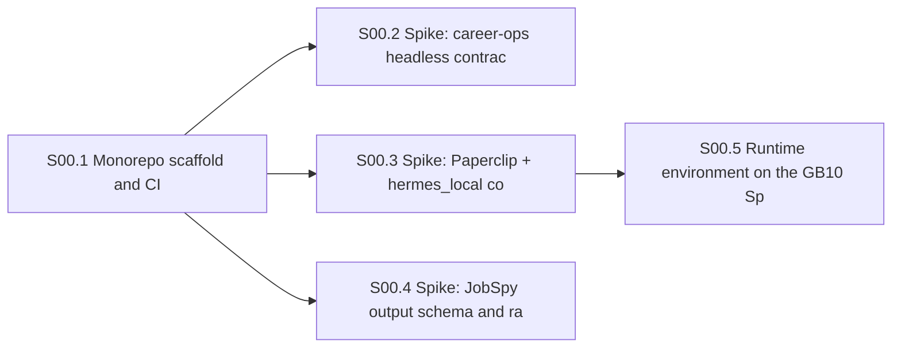

# E00 — Foundations & discovery spikes

| Field | Value |
|---|---|
| Depends on (epics) | — |
| Stories | 5 |
| Estimate | 21 pts |
| Status | To do |

## Goal

Stand up the repo, CI and runtime on the Spark, and de-risk the three external projects (career-ops, Paperclip+Hermes, JobSpy) by capturing their real contracts as fixtures before any wrapper is written.

## Why it matters

All three upstream projects are young and fast-moving, and career-ops was built to be driven interactively by an AI CLI. Building wrappers against assumed interfaces is the biggest risk in the plan.

## Scope

**In scope:**

- Monorepo + CI
- three contract-capture spikes with ADRs and fixtures
- docker compose runtime on the Spark
- LiteLLM routing incl. a mock route

**Out of scope:**

- Any agent behavior
- any production wrapper code

## Stories

| Story | Title | Pts | Wave | Depends on |
|---|---|---|---|---|
| [S00.1](../stories/E00-foundations-spikes/S00.1-monorepo-scaffold-and-ci.md) | Monorepo scaffold and CI | 3 | 1 | — |
| [S00.2](../stories/E00-foundations-spikes/S00.2-spike-career-ops-headless-contract-capture.md) | Spike: career-ops headless contract capture | 5 | 2 | S00.1 |
| [S00.3](../stories/E00-foundations-spikes/S00.3-spike-paperclip-hermes-local-contract-capture.md) | Spike: Paperclip + hermes_local contract capture | 5 | 2 | S00.1 |
| [S00.4](../stories/E00-foundations-spikes/S00.4-spike-jobspy-output-schema-and-rate-limit-behavior.md) | Spike: JobSpy output schema and rate-limit behavior | 3 | 2 | S00.1 |
| [S00.5](../stories/E00-foundations-spikes/S00.5-runtime-environment-on-the-gb10-spark.md) | Runtime environment on the GB10 Spark | 5 | 3 | S00.3 |

## Story dependency graph

## Test coverage by type

| Type | Story-level test cases |
|---|---|
| `contract` | 9 |
| `integration` | 4 |
| `unit` | 6 |

## Exit criteria

- [ ] CI runs unit + contract suites on every PR in under 10 minutes
- [ ] ADR-1..ADR-8 written and accepted by Doc
- [ ] Fixture packs exist for career-ops, Paperclip API/adapter and JobSpy, each with a README stating the upstream commit/version
- [ ] `docker compose up` on the Spark brings Paperclip, LiteLLM and placeholder services up healthy

## Definition of done (epic)

- [ ] All stories Done
- [ ] Exit criteria above met
- [ ] Integration suite green on `main`
- [ ] Docs/runbook section written
- [ ] 5-minute demo to Doc
