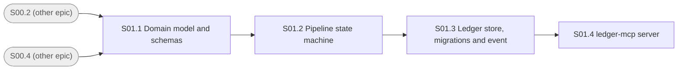

# E01 — Domain core & pipeline ledger

| Field | Value |
|---|---|
| Depends on (epics) | [E00](E00-foundations-spikes.md) |
| Stories | 4 |
| Estimate | 16 pts |
| Status | To do |

## Goal

Build the JobOps Ledger, the single source of truth for every job, its artifacts, reviews and inbox events, with a guarded state machine and an MCP surface agents use.

## Why it matters

Every agent coordinates through job state. Getting the state machine and idempotency right first makes every later story simpler to test.

## Scope

**In scope:**

- Pydantic domain model + JSON Schema export
- state machine
- SQLite store + migrations + event log
- ledger-mcp

**Out of scope:**

- Projections to Notion/Paperclip (E10/E04)

## Stories

| Story | Title | Pts | Wave | Depends on |
|---|---|---|---|---|
| [S01.1](../stories/E01-domain-ledger/S01.1-domain-model-and-schemas.md) | Domain model and schemas | 3 | 3 | S00.2, S00.4 |
| [S01.2](../stories/E01-domain-ledger/S01.2-pipeline-state-machine.md) | Pipeline state machine | 5 | 4 | S01.1 |
| [S01.3](../stories/E01-domain-ledger/S01.3-ledger-store-migrations-and-event-log.md) | Ledger store, migrations and event log | 5 | 5 | S01.2 |
| [S01.4](../stories/E01-domain-ledger/S01.4-ledger-mcp-server.md) | ledger-mcp server | 3 | 6 | S01.3 |

## Story dependency graph

## Test coverage by type

| Type | Story-level test cases |
|---|---|
| `component` | 6 |
| `contract` | 2 |
| `guardrail` | 2 |
| `unit` | 8 |

## Exit criteria

- [ ] Every transition in PLAN §4 is covered by a test; every illegal transition is rejected
- [ ] Event log is append-only and replayable to rebuild current state
- [ ] ledger-mcp contract tests green

## Definition of done (epic)

- [ ] All stories Done
- [ ] Exit criteria above met
- [ ] Integration suite green on `main`
- [ ] Docs/runbook section written
- [ ] 5-minute demo to Doc
