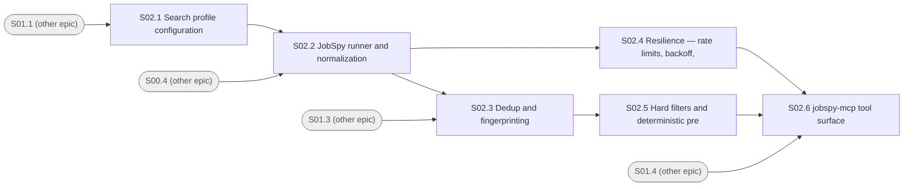

# E02 — JobSpy discovery service

| Field | Value |
|---|---|
| Depends on (epics) | [E00](E00-foundations-spikes.md), [E01](E01-domain-ledger.md) |
| Stories | 6 |
| Estimate | 20 pts |
| Status | To do |

## Goal

Wrap JobSpy as a resilient, typed discovery service that turns search profiles into normalized, de-duplicated, pre-screened Job records.

## Why it matters

Raw JobSpy output varies by site, includes duplicates across boards and fails per site under rate limits. Agents need a clean, stable tool.

## Scope

**In scope:**

- Search profile config
- runner + normalization
- fingerprint dedup
- resilience
- hard filters
- jobspy-mcp

**Out of scope:**

- LLM evaluation (E03/E06)

## Stories

| Story | Title | Pts | Wave | Depends on |
|---|---|---|---|---|
| [S02.1](../stories/E02-jobspy-discovery/S02.1-search-profile-configuration.md) | Search profile configuration | 2 | 4 | S01.1 |
| [S02.2](../stories/E02-jobspy-discovery/S02.2-jobspy-runner-and-normalization.md) | JobSpy runner and normalization | 5 | 5 | S02.1, S00.4 |
| [S02.3](../stories/E02-jobspy-discovery/S02.3-dedup-and-fingerprinting.md) | Dedup and fingerprinting | 5 | 6 | S02.2, S01.3 |
| [S02.4](../stories/E02-jobspy-discovery/S02.4-resilience-rate-limits-backoff-proxies-per-site-isolation.md) | Resilience — rate limits, backoff, proxies, per-site isolation | 3 | 6 | S02.2 |
| [S02.5](../stories/E02-jobspy-discovery/S02.5-hard-filters-and-deterministic-pre-screen.md) | Hard filters and deterministic pre-screen | 2 | 7 | S02.3 |
| [S02.6](../stories/E02-jobspy-discovery/S02.6-jobspy-mcp-tool-surface.md) | jobspy-mcp tool surface | 3 | 8 | S02.4, S02.5, S01.4 |

## Story dependency graph

## Test coverage by type

| Type | Story-level test cases |
|---|---|
| `component` | 3 |
| `contract` | 2 |
| `eval` | 1 |
| `guardrail` | 1 |
| `unit` | 15 |

## Exit criteria

- [ ] A search profile run produces normalized Jobs with < 2% duplicates on the fixture corpus
- [ ] A site failure never fails the whole run
- [ ] jobspy-mcp contract tests green

## Definition of done (epic)

- [ ] All stories Done
- [ ] Exit criteria above met
- [ ] Integration suite green on `main`
- [ ] Docs/runbook section written
- [ ] 5-minute demo to Doc
