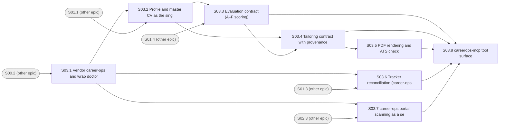

# E03 — career-ops bridge

| Field | Value |
|---|---|
| Depends on (epics) | [E00](E00-foundations-spikes.md), [E01](E01-domain-ledger.md), [E02](E02-jobspy-discovery.md) |
| Stories | 8 |
| Estimate | 30 pts |
| Status | To do |

## Goal

Integrate career-ops as a pinned dependency and expose its evaluation, tailoring, PDF, scanning and tracker capabilities as validated, typed tools.

## Why it matters

career-ops holds the domain intelligence (A–F evaluation, ATS-oriented CVs). The bridge makes it callable by agents with schema-checked outputs and a no-fabrication guarantee.

## Scope

**In scope:**

- Submodule + doctor
- profile/master CV
- evaluation contract
- tailoring contract with provenance
- PDF + ATS check
- tracker reconciliation
- portal scan
- careerops-mcp

**Out of scope:**

- Deciding which jobs to tailor (E05)

## Stories

| Story | Title | Pts | Wave | Depends on |
|---|---|---|---|---|
| [S03.1](../stories/E03-careerops-bridge/S03.1-vendor-career-ops-and-wrap-doctor.md) | Vendor career-ops and wrap doctor | 2 | 3 | S00.2 |
| [S03.2](../stories/E03-careerops-bridge/S03.2-profile-and-master-cv-as-the-single-source.md) | Profile and master CV as the single source | 3 | 4 | S03.1, S01.1 |
| [S03.3](../stories/E03-careerops-bridge/S03.3-evaluation-contract-a-f-scoring.md) | Evaluation contract (A–F scoring) | 5 | 7 | S03.2, S01.4 |
| [S03.4](../stories/E03-careerops-bridge/S03.4-tailoring-contract-with-provenance-no-fabrication.md) | Tailoring contract with provenance (no fabrication) | 8 | 8 | S03.2, S03.3 |
| [S03.5](../stories/E03-careerops-bridge/S03.5-pdf-rendering-and-ats-check.md) | PDF rendering and ATS check | 3 | 9 | S03.4 |
| [S03.6](../stories/E03-careerops-bridge/S03.6-tracker-reconciliation-career-ops-ledger.md) | Tracker reconciliation (career-ops ↔ ledger) | 3 | 6 | S03.1, S01.3 |
| [S03.7](../stories/E03-careerops-bridge/S03.7-career-ops-portal-scanning-as-a-second-discovery-source.md) | career-ops portal scanning as a second discovery source | 3 | 7 | S03.1, S02.3 |
| [S03.8](../stories/E03-careerops-bridge/S03.8-careerops-mcp-tool-surface.md) | careerops-mcp tool surface | 3 | 10 | S03.3, S03.4, S03.5, S03.6, S03.7 |

## Story dependency graph

## Test coverage by type

| Type | Story-level test cases |
|---|---|
| `component` | 9 |
| `contract` | 4 |
| `eval` | 1 |
| `guardrail` | 5 |
| `unit` | 6 |

## Exit criteria

- [ ] Evaluation and tailoring outputs are schema-validated; invalid output is rejected with a reason
- [ ] Provenance check flags 100% of seeded fabricated claims in the fixture set
- [ ] Upgrading the submodule runs the contract suite and fails loudly on breaking change

## Definition of done (epic)

- [ ] All stories Done
- [ ] Exit criteria above met
- [ ] Integration suite green on `main`
- [ ] Docs/runbook section written
- [ ] 5-minute demo to Doc
