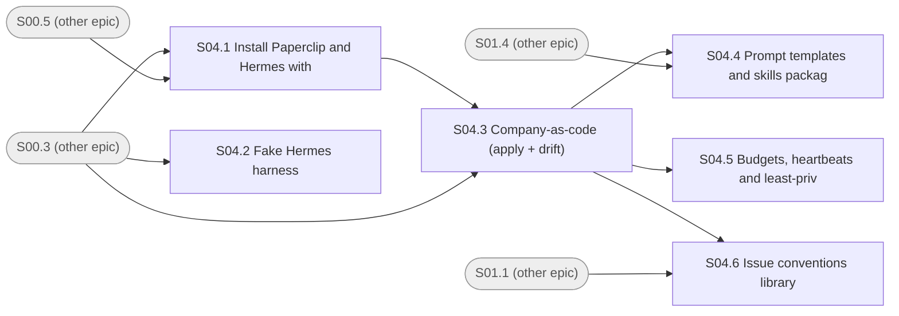

# E04 — Paperclip company & Hermes runtime

| Field | Value |
|---|---|
| Depends on (epics) | [E00](E00-foundations-spikes.md), [E01](E01-domain-ledger.md) |
| Stories | 6 |
| Estimate | 24 pts |
| Status | To do |

## Goal

Run Paperclip with five Hermes agents defined as code, with least-privilege tools, budgets and heartbeats, plus a fake-Hermes harness so orchestration can be tested without LLMs.

## Why it matters

This is the orchestration backbone; company-as-code and fake Hermes are what make it testable.

## Scope

**In scope:**

- Install + health
- fake-hermes harness
- company-as-code apply/drift
- prompt templates + skills
- budgets/heartbeats/toolsets
- issue conventions library

**Out of scope:**

- Agent decision logic (E05–E09)

## Stories

| Story | Title | Pts | Wave | Depends on |
|---|---|---|---|---|
| [S04.1](../stories/E04-paperclip-hermes-runtime/S04.1-install-paperclip-and-hermes-with-litellm-as-provider.md) | Install Paperclip and Hermes with LiteLLM as provider | 3 | 4 | S00.3, S00.5 |
| [S04.2](../stories/E04-paperclip-hermes-runtime/S04.2-fake-hermes-harness.md) | Fake Hermes harness | 5 | 3 | S00.3 |
| [S04.3](../stories/E04-paperclip-hermes-runtime/S04.3-company-as-code-apply-drift.md) | Company-as-code (apply + drift) | 5 | 5 | S04.1, S00.3 |
| [S04.4](../stories/E04-paperclip-hermes-runtime/S04.4-prompt-templates-and-skills-packaging.md) | Prompt templates and skills packaging | 5 | 7 | S04.3, S01.4 |
| [S04.5](../stories/E04-paperclip-hermes-runtime/S04.5-budgets-heartbeats-and-least-privilege-toolsets.md) | Budgets, heartbeats and least-privilege toolsets | 3 | 6 | S04.3 |
| [S04.6](../stories/E04-paperclip-hermes-runtime/S04.6-issue-conventions-library.md) | Issue conventions library | 3 | 6 | S04.3, S01.1 |

## Story dependency graph

## Test coverage by type

| Type | Story-level test cases |
|---|---|
| `component` | 1 |
| `contract` | 1 |
| `guardrail` | 1 |
| `integration` | 7 |
| `unit` | 6 |

## Exit criteria

- [ ] `jobops company apply` is idempotent and reports drift
- [ ] An integration test assigns an issue to each agent and observes fake-Hermes run + report back
- [ ] Each agent can only reach its allow-listed MCP tools (verified by test)

## Definition of done (epic)

- [ ] All stories Done
- [ ] Exit criteria above met
- [ ] Integration suite green on `main`
- [ ] Docs/runbook section written
- [ ] 5-minute demo to Doc
