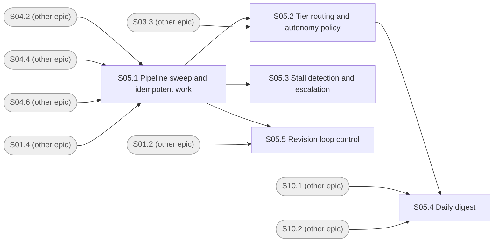

# E05 — Manager agent

| Field | Value |
|---|---|
| Depends on (epics) | [E01](E01-domain-ledger.md), [E03](E03-careerops-bridge.md), [E04](E04-paperclip-hermes-runtime.md), [E10](E10-human-interface.md) |
| Stories | 5 |
| Estimate | 17 pts |
| Status | To do |

## Goal

The Manager sweeps the ledger, creates and assigns work to the right agent, enforces tiers and revision caps, detects stalls and keeps Doc informed with a daily digest.

## Why it matters

Doc asked for a manager that oversees the process; this is the control loop.

## Scope

**In scope:**

- Sweep + idempotent issue creation
- tier routing
- stall detection/escalation
- daily digest
- revision loop control

**Out of scope:**

- Doing the specialist work itself

## Stories

| Story | Title | Pts | Wave | Depends on |
|---|---|---|---|---|
| [S05.1](../stories/E05-manager-agent/S05.1-pipeline-sweep-and-idempotent-work-creation.md) | Pipeline sweep and idempotent work creation | 5 | 8 | S04.2, S04.4, S04.6, S01.4 |
| [S05.2](../stories/E05-manager-agent/S05.2-tier-routing-and-autonomy-policy.md) | Tier routing and autonomy policy | 3 | 9 | S05.1, S03.3 |
| [S05.3](../stories/E05-manager-agent/S05.3-stall-detection-and-escalation.md) | Stall detection and escalation | 3 | 9 | S05.1 |
| [S05.4](../stories/E05-manager-agent/S05.4-daily-digest.md) | Daily digest | 3 | 10 | S05.2, S10.1, S10.2 |
| [S05.5](../stories/E05-manager-agent/S05.5-revision-loop-control.md) | Revision loop control | 3 | 9 | S05.1, S01.2 |

## Story dependency graph

## Test coverage by type

| Type | Story-level test cases |
|---|---|
| `integration` | 5 |
| `unit` | 10 |

## Exit criteria

- [ ] With fake Hermes, a seeded ledger is routed end to end with zero duplicate issues across 10 consecutive heartbeats
- [ ] Stalled items escalate within one heartbeat of breaching SLA

## Definition of done (epic)

- [ ] All stories Done
- [ ] Exit criteria above met
- [ ] Integration suite green on `main`
- [ ] Docs/runbook section written
- [ ] 5-minute demo to Doc
