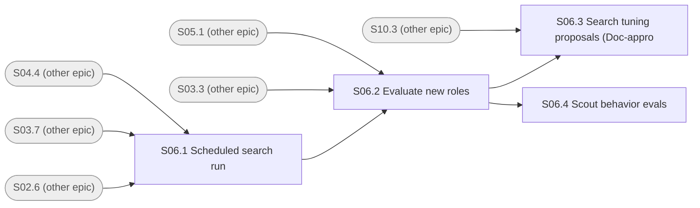

# E06 — Scout agent (search)

| Field | Value |
|---|---|
| Depends on (epics) | [E02](E02-jobspy-discovery.md), [E03](E03-careerops-bridge.md), [E04](E04-paperclip-hermes-runtime.md), [E05](E05-manager-agent.md), [E10](E10-human-interface.md) |
| Stories | 4 |
| Estimate | 14 pts |
| Status | To do |

## Goal

The Scout runs searches on schedule, records discoveries, and evaluates new roles with career-ops so the Manager can route by tier.

## Why it matters

The front of the funnel; quality here sets the whole pipeline's signal-to-noise.

## Scope

**In scope:**

- Scheduled search via jobspy-mcp + career-ops scan
- evaluation
- profile tuning proposals
- behavior evals

**Out of scope:**

- Changing search profiles without Doc's approval

## Stories

| Story | Title | Pts | Wave | Depends on |
|---|---|---|---|---|
| [S06.1](../stories/E06-scout-agent/S06.1-scheduled-search-run.md) | Scheduled search run | 3 | 9 | S02.6, S03.7, S04.4 |
| [S06.2](../stories/E06-scout-agent/S06.2-evaluate-new-roles.md) | Evaluate new roles | 5 | 10 | S06.1, S03.3, S05.1 |
| [S06.3](../stories/E06-scout-agent/S06.3-search-tuning-proposals-doc-approved.md) | Search tuning proposals (Doc-approved) | 3 | 14 | S06.2, S10.3 |
| [S06.4](../stories/E06-scout-agent/S06.4-scout-behavior-evals.md) | Scout behavior evals | 3 | 11 | S06.2 |

## Story dependency graph

## Test coverage by type

| Type | Story-level test cases |
|---|---|
| `agent` | 1 |
| `eval` | 2 |
| `guardrail` | 1 |
| `integration` | 3 |
| `unit` | 1 |

## Exit criteria

- [ ] Scout eval suite meets scoring-consistency target (same JD scored within ±0.5 across 3 runs)
- [ ] No duplicate evaluations in a 7-day shadow run

## Definition of done (epic)

- [ ] All stories Done
- [ ] Exit criteria above met
- [ ] Integration suite green on `main`
- [ ] Docs/runbook section written
- [ ] 5-minute demo to Doc
