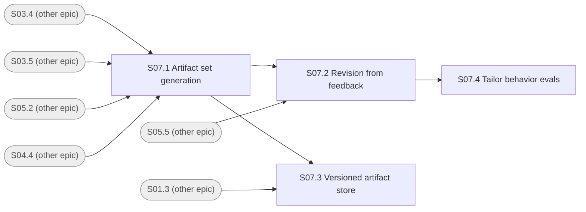

# E07 — Tailor agent (artifacts)

| Field | Value |
|---|---|
| Depends on (epics) | [E01](E01-domain-ledger.md), [E03](E03-careerops-bridge.md), [E04](E04-paperclip-hermes-runtime.md), [E05](E05-manager-agent.md) |
| Stories | 4 |
| Estimate | 14 pts |
| Status | To do |

## Goal

The Tailor creates and revises the artifact set (tailored CV, cover letter, PDF) for shortlisted jobs, versioned and traceable.

## Why it matters

This is the "agent to update the artifacts" Doc asked for.

## Scope

**In scope:**

- Artifact set generation
- revision from feedback
- versioned artifact store
- behavior evals

**Out of scope:**

- Approving its own work

## Stories

| Story | Title | Pts | Wave | Depends on |
|---|---|---|---|---|
| [S07.1](../stories/E07-tailor-agent/S07.1-artifact-set-generation.md) | Artifact set generation | 5 | 10 | S03.4, S03.5, S05.2, S04.4 |
| [S07.2](../stories/E07-tailor-agent/S07.2-revision-from-feedback.md) | Revision from feedback | 3 | 11 | S07.1, S05.5 |
| [S07.3](../stories/E07-tailor-agent/S07.3-versioned-artifact-store.md) | Versioned artifact store | 3 | 11 | S07.1, S01.3 |
| [S07.4](../stories/E07-tailor-agent/S07.4-tailor-behavior-evals.md) | Tailor behavior evals | 3 | 12 | S07.2 |

## Story dependency graph

## Test coverage by type

| Type | Story-level test cases |
|---|---|
| `agent` | 1 |
| `component` | 1 |
| `eval` | 3 |
| `integration` | 1 |
| `unit` | 2 |

## Exit criteria

- [ ] Every artifact version links to inputs, model, prompt version and master-CV hash
- [ ] Revision addresses 100% of Critic findings marked must-fix in eval set

## Definition of done (epic)

- [ ] All stories Done
- [ ] Exit criteria above met
- [ ] Integration suite green on `main`
- [ ] Docs/runbook section written
- [ ] 5-minute demo to Doc
