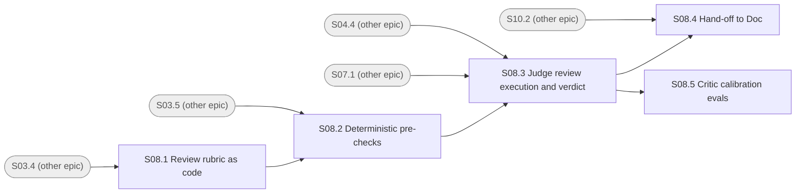

# E08 — Critic agent (review)

| Field | Value |
|---|---|
| Depends on (epics) | [E03](E03-careerops-bridge.md), [E04](E04-paperclip-hermes-runtime.md), [E07](E07-tailor-agent.md), [E10](E10-human-interface.md) |
| Stories | 5 |
| Estimate | 17 pts |
| Status | To do |

## Goal

The Critic reviews every artifact set with deterministic checks plus an independent judge model, and either sends it back with findings or hands it to Doc for approval.

## Why it matters

This is the "agent to review the artifacts before I do" Doc asked for.

## Scope

**In scope:**

- Rubric as code
- deterministic pre-checks
- judge execution + verdicts
- hand-off to Doc
- calibration evals

**Out of scope:**

- Rewriting artifacts itself

## Stories

| Story | Title | Pts | Wave | Depends on |
|---|---|---|---|---|
| [S08.1](../stories/E08-critic-agent/S08.1-review-rubric-as-code.md) | Review rubric as code | 3 | 9 | S03.4 |
| [S08.2](../stories/E08-critic-agent/S08.2-deterministic-pre-checks.md) | Deterministic pre-checks | 3 | 10 | S08.1, S03.5 |
| [S08.3](../stories/E08-critic-agent/S08.3-judge-review-execution-and-verdict.md) | Judge review execution and verdict | 5 | 11 | S08.2, S07.1, S04.4 |
| [S08.4](../stories/E08-critic-agent/S08.4-hand-off-to-doc.md) | Hand-off to Doc | 3 | 12 | S08.3, S10.2 |
| [S08.5](../stories/E08-critic-agent/S08.5-critic-calibration-evals.md) | Critic calibration evals | 3 | 12 | S08.3 |

## Story dependency graph

## Test coverage by type

| Type | Story-level test cases |
|---|---|
| `component` | 1 |
| `eval` | 2 |
| `guardrail` | 1 |
| `integration` | 3 |
| `unit` | 6 |

## Exit criteria

- [ ] Catch rate ≥ 90% on seeded defects, false-positive rate ≤ 15%
- [ ] Nothing reaches READY_FOR_DOC without a PASS verdict recorded

## Definition of done (epic)

- [ ] All stories Done
- [ ] Exit criteria above met
- [ ] Integration suite green on `main`
- [ ] Docs/runbook section written
- [ ] 5-minute demo to Doc
