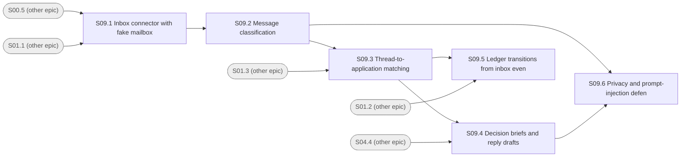

# E09 — Concierge agent (inbox)

| Field | Value |
|---|---|
| Depends on (epics) | [E00](E00-foundations-spikes.md), [E01](E01-domain-ledger.md), [E04](E04-paperclip-hermes-runtime.md), [E05](E05-manager-agent.md) |
| Stories | 6 |
| Estimate | 23 pts |
| Status | To do |

## Goal

The Concierge watches Doc's inbox, classifies job-related messages, ties them to applications, updates the ledger and creates decision briefs with draft replies for Doc.

## Why it matters

This is the "agent to watch my inbox and create things for me to consider" Doc asked for.

## Scope

**In scope:**

- Gmail/IMAP connector with fakes
- classification
- thread matching
- decision briefs + drafts
- ledger transitions
- privacy and injection defenses

**Out of scope:**

- Sending email
- accepting/declining anything

## Stories

| Story | Title | Pts | Wave | Depends on |
|---|---|---|---|---|
| [S09.1](../stories/E09-concierge-agent/S09.1-inbox-connector-with-fake-mailbox.md) | Inbox connector with fake mailbox | 5 | 4 | S00.5, S01.1 |
| [S09.2](../stories/E09-concierge-agent/S09.2-message-classification.md) | Message classification | 5 | 5 | S09.1 |
| [S09.3](../stories/E09-concierge-agent/S09.3-thread-to-application-matching.md) | Thread-to-application matching | 3 | 6 | S09.2, S01.3 |
| [S09.4](../stories/E09-concierge-agent/S09.4-decision-briefs-and-reply-drafts.md) | Decision briefs and reply drafts | 5 | 8 | S09.3, S04.4 |
| [S09.5](../stories/E09-concierge-agent/S09.5-ledger-transitions-from-inbox-events.md) | Ledger transitions from inbox events | 2 | 7 | S09.3, S01.2 |
| [S09.6](../stories/E09-concierge-agent/S09.6-privacy-and-prompt-injection-defenses.md) | Privacy and prompt-injection defenses | 3 | 9 | S09.2, S09.4 |

## Story dependency graph

## Test coverage by type

| Type | Story-level test cases |
|---|---|
| `agent` | 1 |
| `component` | 2 |
| `eval` | 2 |
| `guardrail` | 4 |
| `integration` | 1 |
| `unit` | 7 |

## Exit criteria

- [ ] ≥ 95% correct application match and ≥ 90% classification accuracy on the labeled mailbox fixture
- [ ] No code path can send an email (guardrail test)

## Definition of done (epic)

- [ ] All stories Done
- [ ] Exit criteria above met
- [ ] Integration suite green on `main`
- [ ] Docs/runbook section written
- [ ] 5-minute demo to Doc
