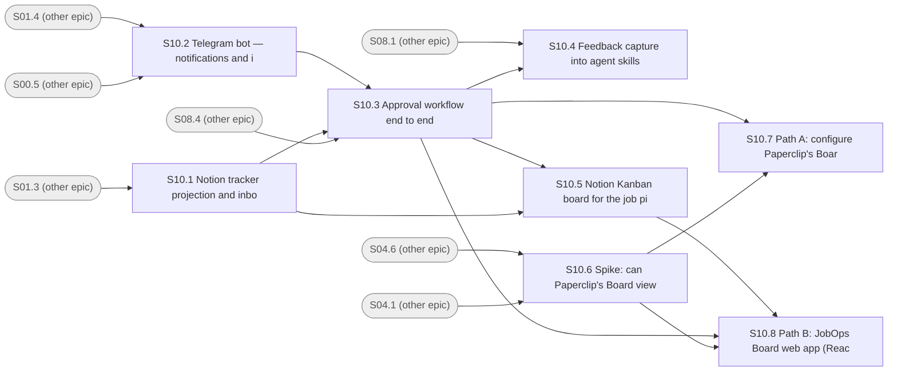

# E10 — Human interface (Notion, Telegram, approvals)

| Field | Value |
|---|---|
| Depends on (epics) | [E00](E00-foundations-spikes.md), [E01](E01-domain-ledger.md), [E04](E04-paperclip-hermes-runtime.md), [E08](E08-critic-agent.md) |
| Stories | 8 |
| Estimate | 33 pts |
| Status | To do |

## Goal

Give Doc a phone-first way to see the pipeline and act on it — Notion as the tracker, Telegram for alerts and one-tap decisions, Paperclip approvals as the system of record.

## Why it matters

Doc is the board. Decisions must be fast and must land back in the ledger correctly.

## Scope

**In scope:**

- Notion projection + inbound commands
- Telegram bot
- approval workflow
- feedback capture
- Kanban boards — a Notion pipeline board, and a parallel agent-work board (Paperclip's Board view or our own dnd-kit web app, decided by a spike)

**Out of scope:**

- Submitting applications on Doc's behalf

## Stories

| Story | Title | Pts | Wave | Depends on |
|---|---|---|---|---|
| [S10.1](../stories/E10-human-interface/S10.1-notion-tracker-projection-and-inbound-commands.md) | Notion tracker projection and inbound commands | 5 | 6 | S01.3 |
| [S10.2](../stories/E10-human-interface/S10.2-telegram-bot-notifications-and-inline-actions.md) | Telegram bot — notifications and inline actions | 5 | 7 | S00.5, S01.4 |
| [S10.3](../stories/E10-human-interface/S10.3-approval-workflow-end-to-end.md) | Approval workflow end to end | 5 | 13 | S08.4, S10.1, S10.2 |
| [S10.4](../stories/E10-human-interface/S10.4-feedback-capture-into-agent-skills.md) | Feedback capture into agent skills | 3 | 14 | S10.3, S08.1 |
| [S10.5](../stories/E10-human-interface/S10.5-notion-kanban-board-for-the-job-pipeline.md) | Notion Kanban board for the job pipeline | 3 | 14 | S10.1, S10.3 |
| [S10.6](../stories/E10-human-interface/S10.6-spike-can-paperclip-s-board-view-drag-and-drop.md) | Spike: can Paperclip's Board view drag and drop? | 2 | 7 | S04.1, S04.6 |
| [S10.7](../stories/E10-human-interface/S10.7-path-a-configure-paperclip-s-board-as-the-agent-work-board.md) | Path A: configure Paperclip's Board as the agent-work board *(conditional)* | 2 | 14 | S10.6, S10.3 |
| [S10.8](../stories/E10-human-interface/S10.8-path-b-jobops-board-web-app-react-dnd-kit.md) | Path B: JobOps Board web app (React + dnd-kit) *(conditional)* | 8 | 15 | S10.6, S10.3, S10.5 |

## Story dependency graph

## Test coverage by type

| Type | Story-level test cases |
|---|---|
| `component` | 9 |
| `contract` | 2 |
| `e2e` | 1 |
| `guardrail` | 8 |
| `integration` | 3 |
| `unit` | 4 |

## Exit criteria

- [ ] Approve/Revise/Skip from Telegram updates Paperclip approval, ledger and Notion within 60s
- [ ] Notion projection can be rebuilt from the ledger with no diff
- [ ] Both Kanban boards allow exactly the moves in board_rules.yaml, and a drag on either reaches the ledger as actor doc

## Definition of done (epic)

- [ ] All stories Done
- [ ] Exit criteria above met
- [ ] Integration suite green on `main`
- [ ] Docs/runbook section written
- [ ] 5-minute demo to Doc
