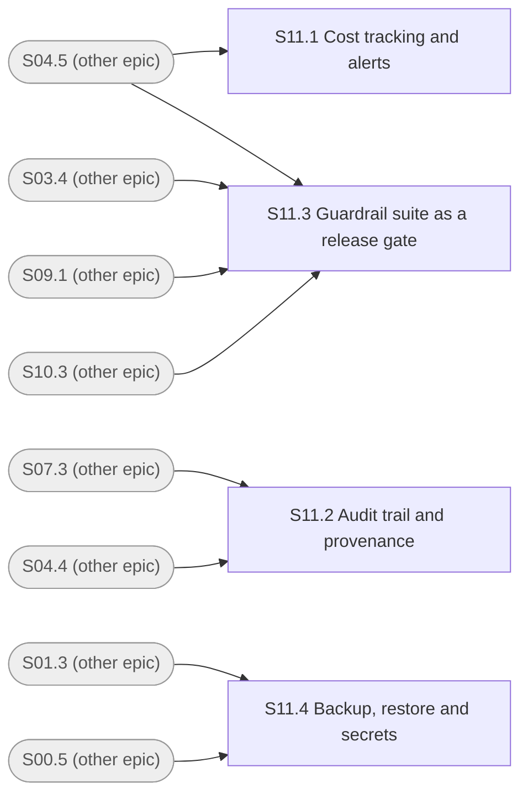

# E11 — Observability, safety & governance

| Field | Value |
|---|---|
| Depends on (epics) | [E00](E00-foundations-spikes.md), [E01](E01-domain-ledger.md), [E03](E03-careerops-bridge.md), [E04](E04-paperclip-hermes-runtime.md), [E07](E07-tailor-agent.md), [E09](E09-concierge-agent.md), [E10](E10-human-interface.md) |
| Stories | 4 |
| Estimate | 11 pts |
| Status | To do |

## Goal

Make cost, behavior and provenance visible, and enforce the safety guarantees as a release-blocking test suite.

## Why it matters

Autonomous agents with access to an inbox and a CV need provable limits.

## Scope

**In scope:**

- Cost tracking + alerts
- audit/provenance
- guardrail suite
- backup/restore + secrets

**Out of scope:**

- —
- —

## Stories

| Story | Title | Pts | Wave | Depends on |
|---|---|---|---|---|
| [S11.1](../stories/E11-observability-safety/S11.1-cost-tracking-and-alerts.md) | Cost tracking and alerts | 3 | 7 | S04.5 |
| [S11.2](../stories/E11-observability-safety/S11.2-audit-trail-and-provenance.md) | Audit trail and provenance | 3 | 12 | S07.3, S04.4 |
| [S11.3](../stories/E11-observability-safety/S11.3-guardrail-suite-as-a-release-gate.md) | Guardrail suite as a release gate | 3 | 14 | S03.4, S04.5, S09.1, S10.3 |
| [S11.4](../stories/E11-observability-safety/S11.4-backup-restore-and-secrets.md) | Backup, restore and secrets | 2 | 6 | S01.3, S00.5 |

## Story dependency graph

## Test coverage by type

| Type | Story-level test cases |
|---|---|
| `component` | 1 |
| `guardrail` | 2 |
| `integration` | 2 |
| `unit` | 2 |

## Exit criteria

- [ ] Guardrail suite is a required CI check and passes
- [ ] Restore drill from backup succeeds in < 15 min
- [ ] Per-agent and per-job cost visible in a daily report

## Definition of done (epic)

- [ ] All stories Done
- [ ] Exit criteria above met
- [ ] Integration suite green on `main`
- [ ] Docs/runbook section written
- [ ] 5-minute demo to Doc
