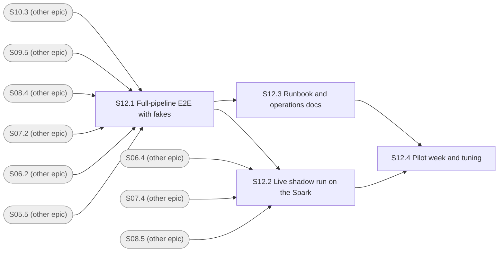

# E12 — Integration, shadow run & release

| Field | Value |
|---|---|
| Depends on (epics) | [E05](E05-manager-agent.md), [E06](E06-scout-agent.md), [E07](E07-tailor-agent.md), [E08](E08-critic-agent.md), [E09](E09-concierge-agent.md), [E10](E10-human-interface.md), [E11](E11-observability-safety.md) |
| Stories | 4 |
| Estimate | 13 pts |
| Status | To do |

## Goal

Prove the whole system end to end, run it in shadow on the Spark with real models, write the runbook and complete a pilot week against the success metrics.

## Why it matters

Confidence that the parts work together, with real data, before Doc relies on it.

## Scope

**In scope:**

- E2E suite with fakes
- live shadow run
- runbook
- pilot + tuning

**Out of scope:**

- —
- —

## Stories

| Story | Title | Pts | Wave | Depends on |
|---|---|---|---|---|
| [S12.1](../stories/E12-integration-release/S12.1-full-pipeline-e2e-with-fakes.md) | Full-pipeline E2E with fakes | 5 | 14 | S05.5, S06.2, S07.2, S08.4, S09.5, S10.3 |
| [S12.2](../stories/E12-integration-release/S12.2-live-shadow-run-on-the-spark.md) | Live shadow run on the Spark | 3 | 15 | S12.1, S06.4, S07.4, S08.5 |
| [S12.3](../stories/E12-integration-release/S12.3-runbook-and-operations-docs.md) | Runbook and operations docs | 2 | 15 | S12.1 |
| [S12.4](../stories/E12-integration-release/S12.4-pilot-week-and-tuning.md) | Pilot week and tuning | 3 | 16 | S12.2, S12.3 |

## Story dependency graph

## Test coverage by type

| Type | Story-level test cases |
|---|---|
| `e2e` | 5 |
| `unit` | 1 |

## Exit criteria

- [ ] E2E happy path and revision path green in CI
- [ ] Pilot week meets PLAN §1 success metrics or has an accepted remediation list

## Definition of done (epic)

- [ ] All stories Done
- [ ] Exit criteria above met
- [ ] Integration suite green on `main`
- [ ] Docs/runbook section written
- [ ] 5-minute demo to Doc
